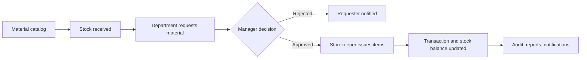
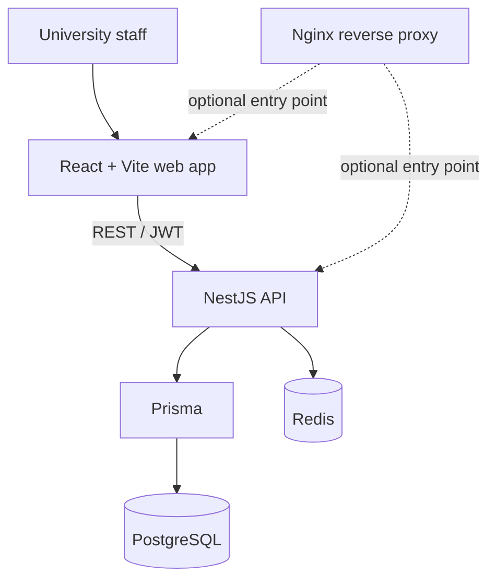

<div align="center">
  
  <h1>AMU Store Inventory &amp; Requisition Management System</h1>
  <p><strong>Material-store operations for Arba Minch University</strong></p>
  <p>Catalog materials · Track stock · Review requests · Record issues · Report activity</p>

  <a href="https://react.dev/"></a>
  <a href="https://vite.dev/"></a>
  <a href="https://www.typescriptlang.org/"></a>
  <a href="https://tailwindcss.com/"></a>
  <br />
  <a href="https://nestjs.com/"></a>
  <a href="https://www.prisma.io/"></a>
  <a href="https://www.postgresql.org/"></a>
  <a href="https://redis.io/"></a>
  <a href="https://docs.docker.com/compose/"></a>
</div>

---

## What it does

This is a web-based **university store inventory and material requisition system**. Staff request materials, store managers review requests, and storekeepers record stock operations and issue approved requests. Audit records, notifications, and reports support day-to-day oversight.

> [!IMPORTANT]
> The current application is focused on materials and store operations. It is **not** a full university ERP or a fixed-asset lifecycle system. The manual documents important implementation limits, including material-wide stock balances and transfer records that do not currently adjust stock.

[Read the system manual →](SYSTEM_DOCUMENTATION.md)

## The main workflow



## Features

| Area | What’s available |
|---|---|
| Materials | Categories, unique material codes, units, locations, barcodes, and minimum-stock thresholds |
| Inventory | Stock-in, stock-out, request-linked returns, physical-count adjustments, and transaction history |
| Requisitions | Department requests with pending, approved, rejected, issued, and cancelled statuses |
| People & suppliers | Department and employee directory, supplier records, and issue history |
| Oversight | Low-stock alerts, in-app notifications, audit logs, dashboard metrics, and eight operational reports |
| Access | JWT authentication, five roles, role guards, and store-scope checks on request decisions |

## Run locally

**Requirements:** Docker with Compose.

```bash
docker compose up -d --build
```

Compose starts PostgreSQL, Redis, the NestJS API, the React web app, and Nginx. The backend container generates the Prisma client, applies migrations, seeds development data, and starts the API.

| Open | Address |
|---|---|
| Web app | [localhost:5173](http://localhost:5173) or [localhost:8080](http://localhost:8080) |
| API | [localhost:3000](http://localhost:3000) |
| Swagger | [localhost:3000/api/docs](http://localhost:3000/api/docs) |

Stop the services and keep the database volume:

```bash
docker compose down
```

Seeded accounts are defined by `backend/prisma/seed.ts`. See `backend/.env.example` for the seed-password variables. Do not use development fallback credentials in a deployed environment.

## Architecture



## Database schema

The entity relationship diagram below shows the Prisma/PostgreSQL data model used by the application. It is maintained alongside the schema at [`backend/prisma/schema.prisma`](backend/prisma/schema.prisma).

<p align="center">
  <a href="backend/prisma/ERD.svg">
    
  </a>
</p>

<p align="center">
  <a href="backend/prisma/ERD.svg">Open the ERD at full size</a>
</p>

<details>
<summary><strong>Repository map</strong></summary>

| Path | Responsibility |
|---|---|
| `frontend/` | React, TypeScript, Vite, and Tailwind CSS application |
| `backend/` | NestJS API, Prisma schema, migrations, and seed data |
| `infra/nginx/` | Local and production Nginx configuration |
| `docker-compose.yml` | Local development stack |
| `docker-compose.prod.yml` | Production Compose stack |

</details>

## Production

The repository includes production Dockerfiles, a production Compose file, and Railway build configuration. Before deployment, configure production database credentials, strong JWT secrets, and explicit seed passwords. Review the deployment configuration and [system manual](SYSTEM_DOCUMENTATION.md) before exposing the app.

---

<div align="center">
  <sub>Built for Arba Minch University · Source code and database schema define the implemented behavior</sub>
</div>
