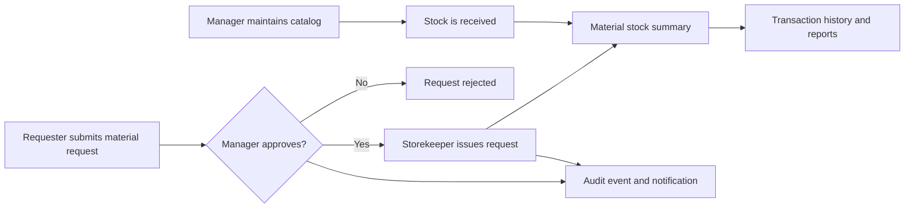
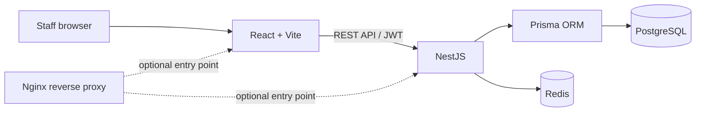

# AMU Store Inventory & Requisition Management System

> **System manual · Current implementation**
> Arba Minch University · Materials, store operations, and departmental requests

This manual describes features represented in the current schema and application code. It is the product documentation source of truth; when code and prose differ, the implementation wins.

  
  
  
  

## Contents

- [Purpose and boundaries](#purpose-and-boundaries)
- [Operational workflow](#operational-workflow)
- [Inventory rules](#inventory-rules)
- [Roles and access](#roles-and-access)
- [Application map](#application-map)
- [Reports and API](#reports-and-api)
- [Data model](#data-model)
- [Architecture and operation](#architecture-and-operation)

## Purpose and boundaries

The system supports university store operations: maintaining a material catalog, recording stock activity, handling department requests, and reviewing operational reports.

### Included today

- Material categories and catalog records
- Stock-in, stock-out, returns, adjustments, and transaction history
- Department material requests, manager decisions, and storekeeper issuance
- Supplier, employee, and department records
- Low-stock reporting, notifications, audit logs, and dashboard metrics

### Not implemented in the current schema

Purchase orders, goods-receipt documents, distribution plans, individually tracked fixed assets, borrowing, maintenance, and disposal are not part of the current application. Older project notes described these as completed; that description was inaccurate.

> [!WARNING]
> **Store records do not currently mean separate store stock.** `Store` exists and requests may reference a store, but `StockSummary` is unique per material. Inventory transactions also have no source-store or destination-store fields. The balance is therefore material-wide, not maintained independently for each store.

## Operational workflow

1. A requester submits a request with a purpose, department, and material quantities. It starts as `PENDING`.
2. A store manager approves or rejects it. Approval is limited by the store-scope check in `RequestsService`.
3. A storekeeper issues an approved request. The service checks store-specific stock, records each stock-out, updates line quantities, and changes the request to `PARTIALLY_ISSUED` or `ISSUED` within a database transaction. Issue requests may include selected line quantities; omitting them issues all outstanding quantities for backward compatibility.
4. The system records audit events and sends notifications for key request and inventory events.

Request statuses are `PENDING`, `APPROVED`, `PARTIALLY_ISSUED`, `REJECTED`, `ISSUED`, and `CANCELLED`.

## Inventory rules

Materials have a unique material code, category, unit, minimum-stock threshold, optional location and barcode, and active/inactive status. `StockSummary` holds received, issued, and remaining quantities for each material.

| Transaction | Implemented effect |
|---|---|
| `STOCK_IN` | Creates a transaction and increases received and remaining quantities. Supplier and unit price may be recorded. |
| `STOCK_OUT` | Creates a transaction, increases the issued total, and decreases remaining quantity after checking that sufficient stock is available. |
| `RETURN` | Accepts a return against an issued request item, capped at the quantity still eligible for return; decreases the issued total and increases remaining quantity. |
| `ADJUSTMENT` | Sets remaining quantity to the submitted physical count and records the reason in the transaction remarks. |
| `TRANSFER` | Records a transfer transaction and department destination. It does **not** update `StockSummary` or move quantities between store balances. |

Stock-in, stock-out, return, adjustment, and request issuance write their transaction and quantity changes together in database transactions. Audit logs are separate operational records; they are not immutable or tamper-proof by design.

## Roles and access

The schema defines five roles. This table summarizes their main intended work; it is not a complete endpoint-by-endpoint permission matrix.

| Role | Main responsibility |
|---|---|
| `ADMINISTRATOR` | User and department administration; can also perform selected inventory operations and request decisions. |
| `STORE_MANAGER` | Material catalog management, request decisions, supplier management, and inventory operations. |
| `STOREKEEPER` | Inventory operations and issuance of approved requests. |
| `REQUESTER` | Submits material requests and follows their status. |
| `AUDITOR` | Reads audit records and operational reports. |

JWT authentication is global, with login, refresh, and registration marked public. `RolesGuard` applies role restrictions where controllers declare them. The request approval service additionally checks store scope: administrators are allowed; a store manager needs `GLOBAL` scope or a matching `STORE` scope. `ORGANIZATION` exists as a scope type, but do not infer that all list and detail APIs filter data by scope.

## Application map

### Backend modules

| Module | Responsibility |
|---|---|
| `auth` | Login, refresh, registration, current user, JWT guards, access checks |
| `users` | User account administration |
| `employees` | Departments, employees, issue history |
| `materials` | Categories and material catalog |
| `inventory` | Stock operations and transaction ledger |
| `requests` | Request submission, decisions, and issuance |
| `suppliers` | Supplier directory |
| `reports` | Operational stock and activity reports |
| `audit` | Audit-log queries |
| `notifications` | User inbox and read state |
| `dashboard` | Inventory summary metrics |

### Frontend routes

The main routes are `/login`, `/`, `/materials`, `/requests`, `/inventory`, `/employees`, `/suppliers`, `/reports`, and `/users`.

## Reports and API

The reports API exposes the following endpoints:

| Endpoint | Report |
|---|---|
| `GET /reports/current-stock` | Current material balances |
| `GET /reports/stock-in` | Receipts |
| `GET /reports/stock-out` | Issues |
| `GET /reports/material-balance` | Received, issued, remaining, and low-stock status |
| `GET /reports/low-stock` | Materials at or below their minimum threshold |
| `GET /reports/employee-issue` | Issues by employee |
| `GET /reports/supplier` | Supplier and recorded supply summary |
| `GET /reports/transaction-history` | Inventory transaction history |

The frontend provides report views and export/print actions. These are operational inventory reports, not financial valuation reports.

## Data model

Primary Prisma models are `Department`, `Store`, `User`, `Employee`, `Supplier`, `MaterialCategory`, `Material`, `StockSummary`, `StockBalance`, `MaterialRequest`, `MaterialRequestItem`, `InventoryTransaction`, `AuditLog`, and `Notification`.

`StockSummary` remains the aggregate compatibility balance while `StockBalance` records the authoritative material balance for a specific store. `StockBalance.reservedQuantity` protects approved request allocations from competing issues; available stock is remaining quantity minus reservations. Inventory mutations use the authenticated user's assigned store; global administrators must provide an explicit store.

Inter-store movement uses `InventoryTransfer` documents. Creating a transfer records a `DRAFT`; dispatch atomically removes available stock from the source store and records a transfer transaction; receipt adds stock to the destination store and completes the document. Transfers cannot be created within the same store or consume reserved stock.

Receiving from a supplier or other source can use `GoodsReceipt` documents. A receipt begins as `DRAFT` and does not change inventory. Inspection records accepted and rejected quantities; those quantities must reconcile to the received quantity, and rejected units require a condition note. Posting is allowed only after inspection, atomically adds accepted units to the receiving store and aggregate compatibility balance, records a `STOCK_IN` transaction, and marks the receipt `POSTED`. Rejected units never enter available inventory.

For exact fields, relations, and enum values, see [`backend/prisma/schema.prisma`](backend/prisma/schema.prisma). The schema and migrations define persisted behavior; this summary is intentionally compact.

## Architecture and operation

| Layer | Technology |
|---|---|
| Web client | React 18, TypeScript, Vite, Tailwind CSS, TanStack Query, Zustand |
| API | NestJS 10, TypeScript, Prisma ORM |
| Database | PostgreSQL 16 |
| Cache / rate-limit support | Redis 7 |
| Local orchestration | Docker Compose and Nginx |

Start the development stack with `docker compose up -d --build`. It starts the database, Redis, API, web client, and reverse proxy. The backend container generates Prisma Client, applies checked-in migrations, seeds development data, and starts the API.

- Web client: <http://localhost:5173> or <http://localhost:8080>
- API: <http://localhost:3000>
- Swagger: <http://localhost:3000/api/docs>

Stop services while retaining the database volume with `docker compose down`. Production configuration is in `docker-compose.prod.yml`, production Dockerfiles, and the Railway JSON files. Configure production database credentials, strong JWT secrets, and seed passwords before deployment. See [`README.md`](README.md) for the quick start.

---

Documentation maintenance: update this manual only after checking the relevant schema, backend service/controller, and frontend screen or route. Keep future plans separate from implemented behavior.
